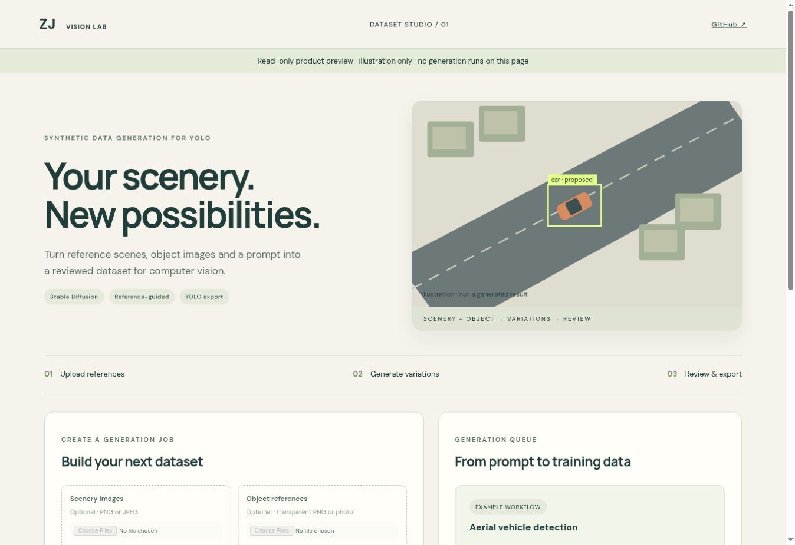

# Synthetic Data Generation for YOLO

A React + FastAPI product prototype for turning **scenery images, optional object references, a text prompt and an image count** into a reviewed synthetic detection dataset.

Example: upload aerial road scenes and a top-down car photo, ask for realistic drone-view vehicle imagery, generate 100 variations, correct proposed boxes, and export YOLO labels.

[Product preview](https://zohaibjan.github.io/synthetic-data-demo/?preview=1) · [Zohaib's portfolio](https://zohaibjan.github.io/) · [Vision Training Hub](https://github.com/zohaibjan/vision-training-hub)



*Actual interface screenshot. The aerial scene is an illustration, not an inference result.*

## What it does

- **Prompt only:** Stable Diffusion text-to-image at 512 × 512.
- **Scenery + prompt:** image-to-image variations of one or several reference images.
- **Scenery + object + prompt:** extract an object cutout, vary its position, scale and rotation, composite it into the scene, then blend with Stable Diffusion image-to-image.
- Upload a sample set at once. Scenes cycle round-robin; objects are selected deterministically from the set. This version inserts one object per image, using the first class in the UI.
- Transparent PNG cutouts work directly. Ordinary photos use optional `rembg` background removal; inspect cutout quality. Supply one isolated object per reference.
- SQLite job queue with a separate serial GPU worker. Closing the browser does not stop the worker.
- Initial boxes from placement, or optional YOLO teacher predictions for prompt-only/scenery-only runs. **These are proposals, not ground truth.**
- Human acceptance/rejection, editable normalized YOLO boxes and a visible overlay. Explicit confirmation required for negative images.
- ZIP export containing accepted images, YOLO labels, `data.yaml`, seeds, source references, review timestamps and provenance.
- Source-scene-disjoint train/validation splits for reference jobs. At least two distinct source scenes must have accepted outputs for a split export. One-scene jobs can use **training-only export**; add a separate real validation set and its `val` path to `data.yaml` before training. Prompt-only jobs use a seeded 80/20 image split.

## Honest scope

This is a working reference implementation, not a validated production data service. **It produces still images, not temporally consistent video.** It does not reconstruct a 3D car from a side-view photo, guarantee object identity, enforce road-aware placement, or preserve every background detail. Use aerial object references for aerial outputs. Random positions may be implausible: reject those images. A future region-mask editor and depth/ControlNet conditioning would improve control.

Diffusion may move, delete or add objects. Review **all** target objects, including objects already present in the background. No automatic performance improvement is claimed. Keep a separate real-world test dataset; synthetic validation only checks the pipeline. Related scenes from the same flight/location must be grouped or excluded manually—the built-in split only groups exact uploaded scene identities.

**Verified:** CPU workflow tests, deterministic compositing, uploads, job states, review, dataset validation/export and React tests/build. **Not yet validated here:** CUDA Stable Diffusion inference, YOLO teacher inference, automatic background-removal inference, visual fidelity and downstream detection gains. The public preview is read-only and uses a clearly labelled SVG illustration, not a generated result.

## Run locally (Python 3.11/3.12, Linux)

```bash
python -m venv .venv
source .venv/bin/activate
pip install -e '.[dev]'
export SYNTH_STATE_DIR="$PWD/state"
export SYNTH_API_TOKEN="$(python -c 'import secrets; print(secrets.token_urlsafe(32))')"
export SYNTH_MODE=demo
uvicorn synth.api:create_app --factory --host 127.0.0.1 --port 8000
```

Open `http://127.0.0.1:8000`, enter your token, and start the worker in a second terminal with the **same** environment and virtual environment:

```bash
python -m synth.worker
```

Demo mode uses geometric test fixtures or unchanged composites; it does not run Stable Diffusion. Worker mode is selected server-side, not by visitors. Uploaded files and generated datasets stay under `SYNTH_STATE_DIR` and are excluded from Git.

## Enable real generation

Install a PyTorch build appropriate for your NVIDIA CUDA driver, then:

```bash
pip install -e '.[generate,cutout,label]'
export SYNTH_MODE=real
export SYNTH_SD_MODEL=/absolute/path/to/local/stable-diffusion-model
export SYNTH_DEVICE=cuda:0
# Optional: trusted local detector weights whose class names match your dataset
export SYNTH_YOLO_MODEL=/absolute/path/to/yolov8n.pt
python -m synth.worker
```

`SYNTH_SD_MODEL` must be an existing Diffusers-format **Stable Diffusion 1.x/2.x** pipeline directory with safetensors and a safety checker. SDXL is not supported by this adapter. Download model weights separately according to their license; no model weights are included. Model loading uses `local_files_only=True`. `rembg` may download its default U2Net weights on first ordinary-photo upload; pre-cache them for offline use. Only use trusted local YOLO weights. The optional teacher matches exact class names and does not learn new classes from the reference image.

The worker processes one job at a time on the configured GPU. It does not schedule across GPUs or coordinate reservations with Vision Training Hub: assign a separate GPU or run them at separate times. Restarting marks running jobs interrupted; queued jobs remain queued. Interrupted or failed jobs cannot export. Stop a worker using Ctrl+C; there is no per-job cancel button in this version.

## Upload and dataset workflow

1. Connect with the API token.
2. Upload scenery and optionally object references. Each selected file set replaces the previous selection of that type. Up to 50 references/type, 12 MB/file, 16 megapixels; metadata is stripped when images are normalized. Scenes are center-cropped to square; inspect that crop in generated results.
3. Enter the prompt, classes, count (2–100), seed, blend strength and object scale. More strength changes the source more. All object references use class 0 through the UI; the API supports `object_class`.
4. Submit. A worker must be running. Open a completed job to review images.
5. Edit box rows in `class_id center_x center_y width height` format, normalized 0–1, or reject the image. This initial editor is numeric, with an overlay; drag-to-draw is not implemented.
6. Accept at least two images. For scenery jobs, accept outputs from at least two distinct scenes for a split export, or select training-only export and add your own real validation set.
7. Unzip into a dataset folder and select that folder in [Vision Training Hub](https://github.com/zohaibjan/vision-training-hub). Start with a small trial and assess on real imagery.

Use flight/site-disjoint **real** validation and test sets for model selection and reporting. Do not treat this app's generated train/val split as evidence of real-world accuracy.

## API

All `/api` endpoints require `Authorization: Bearer <SYNTH_API_TOKEN>`.

| Endpoint | Purpose |
| --- | --- |
| `POST /api/assets` | Multipart `file`, `kind=scene\|object`; returns reference ID |
| `POST /api/jobs` | Prompt, classes, count, scene IDs, object IDs, seed and controls |
| `GET /api/jobs` | Queue and completed/failed jobs |
| `GET /api/jobs/{id}/samples` | Generated images and proposed/reviewed boxes |
| `GET /api/samples/{id}/image` | Authenticated PNG |
| `PUT /api/samples/{id}` | Accept/reject/pending, boxes, negative confirmation |
| `GET /api/jobs/{id}/export` | Reviewed YOLO ZIP |

Run one worker per state directory. A process-held lock enforces this. The API is intended for a trusted single-user host, bound to localhost. For remote use, add HTTPS, reverse-proxy upload/body limits, authentication per user, storage quotas and rate limits. A shared bearer token is not tenant isolation. No API tokens, uploaded references, model weights or generated private datasets belong in the public repository.

## Development and checks

The built frontend is committed, so the Python app works without Node. To change it, use Node 22:

```bash
npm ci --prefix frontend
npm test --prefix frontend
npm run build --prefix frontend
python -m pytest -q
```

`npm run dev --prefix frontend` proxies API requests to port 8000. Rebuild and commit `synth/static/` after changing the UI. GitHub Actions tests Python 3.11/3.12 and the React app.

Before describing real inference as verified, run a CUDA acceptance check: two aerial scenes + a suitable car cutout → at least 10 outputs → inspect viewpoint, identity, all boxes and shadows → accept/reject → export → load in Ultralytics → train a small baseline and compare on a held-out real dataset. Record hardware, model revision, seeds and results.

## References and license

- [Diffusers image-to-image API](https://huggingface.co/docs/diffusers/api/pipelines/stable_diffusion/img2img)
- [Ultralytics detection dataset format](https://docs.ultralytics.com/datasets/detect/)
- [rembg](https://github.com/danielgatis/rembg)

Code: AGPL-3.0-or-later. Dependency and model-weight licenses are separate. No model weights or user reference images are bundled. Independently built project by Muhammad Zohaib Jan.
